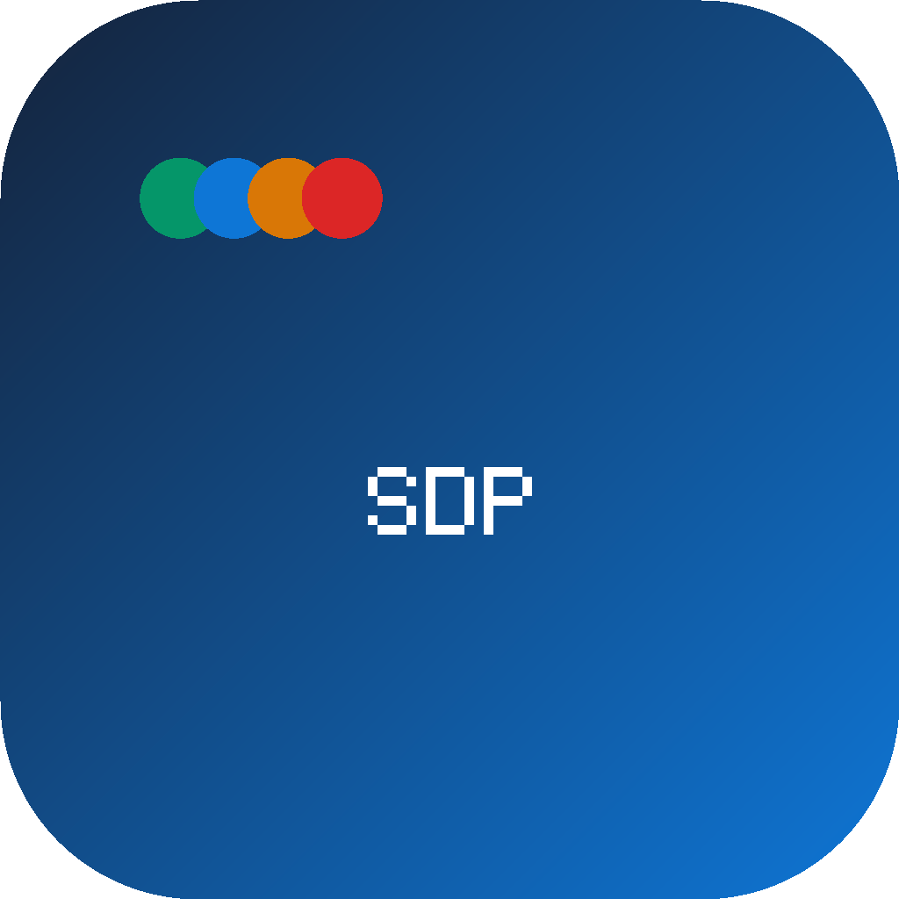

# SalesDesk Pro

<div align="center">



### Personal Sales Desk untuk Tim — 100% Offline · 100% Gratis · Windows 10/11

*Buka dashboard pagi, langsung tahu kondisi seluruh tim — tanpa cloud, tanpa langganan, tanpa spreadsheet.*

[](https://github.com/verycoolapps/SalesManagement/releases)
[](https://github.com/verycoolapps/SalesManagement)
[](#keamanan)
[](LICENSE.md)
[](https://verycoolapps.id)

> **© 2026 VeryCoolApps — PT. Agra Karya Digital**
>
> 📱 WhatsApp: [+62 815-1925-0845](https://wa.me/6281519250845) &nbsp;·&nbsp; ✈️ Telegram: [@VeryCoolApps](https://t.me/VeryCoolApps)

</div>

---

## TL;DR

Install sekali, buka setiap pagi, tim kamu punya **CRM + mesin komisi + dashboard performa** — semuanya berjalan di laptop, tanpa internet, tanpa biaya bulanan, selamanya.

---

## Tampilan Aplikasi

### Layar Login

```
╔══════════════════════════════════════════════════════╗
║                                                      ║
║                       📈                            ║
║                  SalesDesk Pro                       ║
║          Personal Sales Desk untuk Tim               ║
║          100% Offline · 100% Gratis                  ║
║                                                      ║
║   ┌──────────────────────────────────────────────┐  ║
║   │  Username                                    │  ║
║   └──────────────────────────────────────────────┘  ║
║   ┌──────────────────────────────────────────────┐  ║
║   │  Password                           ········  │  ║
║   └──────────────────────────────────────────────┘  ║
║                                                      ║
║   ┌──────────────────────────────────────────────┐  ║
║   │            ▶  Masuk                          │  ║
║   └──────────────────────────────────────────────┘  ║
║                                                      ║
║   Gagal login 5× akan terkunci 30 detik              ║
║   © 2026 VeryCoolApps · WA +62 815-1925-0845         ║
╚══════════════════════════════════════════════════════╝
```

### Dashboard Utama (19 Widget)

```
╔══════════════════════════════════════════════════════════════════════════════════════╗
║  SalesDesk Pro                          🔍 Cari prospek, deal, kontak...    👤 Admin ▾ ║
╠══════════╦═══════════════════════════════════════════════════════════════════════════╣
║          ║  [ Hari Ini ▾ ]  [ Minggu Ini ]  [ Bulan Ini ]                           ║
║ 🏠 Dashboard ╠═══════════╦═══════════╦══════════╦══════════════════════════════════╣
║          ║  💰 Revenue  │ 🎯 Target  │ 💵 Komisi │  ✨ Prospek Baru                  ║
║ 👥 Prospek  ║ Rp 234 jt  │ Rp 300 jt │ Rp 12,5jt│  47      ▲ +12% vs kemarin       ║
║          ╠═══════════╩═══════════╩══════════╩══════════════════════════════════╣
║ 📇 Kontak   ║                                                                        ║
║          ║  🔥 Prioritas Hari Ini    │  🗓️ Meeting Hari Ini  │  ⏰ Follow-up Due     ║
║ 📊 Pipeline ║  ┌────────────────────┐  │  ┌──────────────────┐│  ┌────────────────┐  ║
║          ║  │ 1. PT Maju Bersama  │  │  │ 10:00 Presentasi ││  │ ⚠ 3 overdue    │  ║
║ 📅 Follow-up║  │    Rp 45jt · Won?  │  │  │    PT Sumber Jaya││  │ • Fuad - 2hr   │  ║
║          ║  │ 2. CV Harapan Jaya  │  │  │ 14:30 Demo Produk││  │ • Budi - 1hr   │  ║
║ 🗓️ Meeting  ║  │    Rp 22jt · Nego  │  │  └──────────────────┘│  │ • Sari - kemarin│  ║
║          ║  └────────────────────┘  │                        │  └────────────────┘  ║
║ 🎯 Target   ╠═════════════════════════╪═══════════════════════╪═════════════════════╣
║          ║  📈 Weekly Performance   │  🏅 Scorecard Saya     │  ⚡ Quick Actions     ║
║ 💰 Komisi   ║  █▅▇▃▆▄█▆ ▓▓░░░░░░░   │  ┌──────────────────┐  │  [+ Prospek]          ║
║          ║  Rp 48jt · Rp 62jt      │  │    ████████       │  │  [+ Follow-up]        ║
║ 📈 Laporan  ║  Mon→Sun               │  │       78/100      │  │  [+ Meeting]          ║
║          ║                         │  │    Performa Baik  │  │  [+ Deal]             ║
║ 🛡️ Admin    ║                         │  └──────────────────┘  │                       ║
╚══════════╩═════════════════════════════════════════════════════════════════════════╝
```

---

## Kenapa SalesDesk Pro?

Di antara ribuan aplikasi CRM berbayar yang ada, SalesDesk Pro hadir dengan filosofi berbeda: **data penjualan tim kamu adalah aset, bukan leverage vendor.** Tidak ada server yang bisa dimatikan, tidak ada harga yang bisa naik, tidak ada data yang dikirim ke manapun.

| Yang Biasanya Ada di CRM Lain | SalesDesk Pro |
|:---|:---|
| Langganan bulanan Rp 500rb–5jt/bulan/user | ✅ **Gratis selamanya** |
| Data tersimpan di server vendor luar negeri | ✅ **Data di laptop kamu, terenkripsi** |
| Butuh internet untuk kerja | ✅ **100% offline** |
| Loading lambat tergantung kecepatan internet | ✅ **Buka seketika, SQLite lokal** |
| Fitur dikunci di balik paywall | ✅ **Semua fitur terbuka** |
| Setup rumit, perlu IT admin | ✅ **Install < 2 menit, langsung pakai** |

---

## Fitur Lengkap

### 📊 Dashboard — 19 Widget Real-Time

Dashboard SalesDesk Pro bukan sekadar tabel data. Setiap pagi, tim sales kamu buka satu layar dan langsung tahu **apa yang harus dikerjakan sekarang**, bukan harus buka spreadsheet dan filter manual.

**Widget Monitoring:**
| Widget | Fungsi |
|:---|:---|
| 💰 **Revenue Bulan Ini** | Total deal Won bulan berjalan + delta vs periode sebelumnya |
| 🎯 **Progress Target** | Progress bar visual menuju target bulanan dengan persentase |
| 💵 **Komisi Terkonfirmasi** | Jumlah komisi yang sudah dikonfirmasi oleh Manager |
| 📊 **Proyeksi Komisi** | Estimasi komisi dari deal-deal yang masih Open |
| ✨ **Prospek Baru** | Jumlah prospek baru dengan perbandingan periode sebelumnya |
| 🔗 **Open Opportunities** | Total nilai pipeline yang masih aktif |
| 🔥 **Closing Soon ≤7 hari** | Deal yang estimated close dalam 7 hari ke depan — fokus di sini |

**Widget Prioritas Harian:**
| Widget | Fungsi |
|:---|:---|
| ⭐ **Today's Priorities** | Follow-up dan deal berdasarkan urgensi dan deadline |
| 🗓️ **Meeting Hari Ini** | Meeting terjadwal dengan countdown pengingat |
| ⏰ **Follow-ups Due Today** | Yang harus diselesaikan hari ini |
| ⚠️ **Overdue Follow-ups** | Yang sudah terlewat — merah, tidak bisa diabaikan |
| 📅 **Upcoming Deadlines** | Deadline deal dan follow-up dalam 7 hari ke depan |
| 🕒 **Recent Activity** | Feed aktivitas terbaru seluruh tim |

**Widget Performa:**
| Widget | Fungsi |
|:---|:---|
| 📈 **Weekly Performance** | Bar chart nilai deal 7 hari terakhir |
| 📉 **Monthly Performance** | Line chart trend 12 bulan ke belakang |
| 🏅 **Personal Scorecard** | Gauge 0–100 yang dihitung dari win rate, aktivitas, dan pencapaian target |
| ⚡ **Quick Actions** | Tombol shortcut langsung ke form baru (Prospek, Follow-up, Meeting, Deal) |

---

### 💰 Mesin Komisi Otomatis

Tidak perlu lagi hitung komisi manual di spreadsheet setiap akhir bulan. SalesDesk Pro menghitung otomatis saat deal dikonfirmasi Won.

**Tiga jenis skema komisi yang didukung:**

```
1. PERSENTASE — % tetap dari nilai deal
   Contoh: setiap deal Won → 2,5% × nilai deal
   Cocok untuk: tim dengan deal size seragam

2. TIER — semakin besar deal, semakin besar %
   Contoh:
     < Rp 10 jt  → 1%
     Rp 10–50 jt → 2,5%
     > Rp 50 jt  → 4%
   Cocok untuk: tim B2B dengan variasi deal besar

3. TARGET-BASED — bonus % hanya jika target tercapai
   Contoh: komisi 3% hanya untuk sales yang capai ≥80% target bulan ini
   Cocok untuk: tim yang butuh motivasi berbasis target
```

**Alur komisi:**
```
Deal dibuat → Tim Leader / Manager konfirmasi "Won"
  → Komisi dihitung otomatis berdasarkan skema aktif
  → Status: Draft
  → Manager bisa Override (dengan catatan alasan)
  → True-up bulanan rekonsiliasi semua komisi
  → Status: Confirmed → tampil di scorecard sales
```

---

### 📋 CRM Pipeline — Kanban Visual

Pipeline SalesDesk Pro berbasis Kanban — drag card antar tahapan langsung di layar, tidak perlu klik-klik form. Stage pipeline bisa dikustomisasi sesuai proses bisnis kamu.

**Default stages:** Prospek → Kualifikasi → Penawaran → Deal  
**Bisa tambah/edit stage** dari menu Pengaturan → Pipeline Stages

Aturan penting:
- **Deal Won** hanya bisa dikonfirmasi oleh Team Leader atau Manager ke atas
- **Deal Lost** wajib disertai alasan — tersimpan di audit log, bisa di-review
- **Drag** kartu antar stage langsung mencatat aktivitas otomatis

---

### 👥 Manajemen Prospek & Kontak

Prospek (lead) dan Kontak (person of contact) dikelola terpisah untuk fleksibilitas. Satu kontak bisa terhubung ke banyak prospek.

**Prospek:**
- Nama perusahaan / individu, source, estimated value
- Stage manual atau ikuti pipeline deal
- Owner (siapa yang handle) + team
- Import massal via CSV (format template tersedia)
- Soft delete dengan recycle bin — bisa dipulihkan

**Kontak:**
- Nama, jabatan, email, nomor HP, perusahaan
- Terhubung ke prospek dan deal
- Catatan bebas

---

### 📥 Import & Export

| Format | Fungsi | Keterangan |
|:---|:---|:---|
| **CSV Import** | Import prospek massal | Template kolom tersedia di docs |
| **Excel Export** | Laporan profesional | Prospek, deal, komisi, performa tim |
| **CSV Export** | Data mentah | Untuk analisis di Power BI / Google Sheets |
| **Backup `.sdpbak`** | Backup database | Terenkripsi AES-256, portabel |

---

### 🛡️ Keamanan Enterprise-Grade

SalesDesk Pro dibangun dengan standar keamanan yang biasanya hanya ada di software enterprise berbayar.

```
Password   → PBKDF2-SHA256 · 100.000 iterasi · salt unik per user
             Lockout 5× gagal → kunci 30 detik
Database   → AES-256-GCM at-rest encryption
             Kunci derived dari fingerprint mesin + master key
Audit Log  → Append-only · tidak bisa diedit via UI
             Setiap aksi kritis wajib disertai alasan
Auto Lock  → Kunci otomatis setelah idle (default: 10 menit)
DevTools   → Dinonaktifkan total di build produksi
Integrity  → App verifikasi hash file inti saat startup
             Jika dimodifikasi → mode tamper screen, akses ditolak
```

---

### 🔔 Notifikasi Desktop

- **Meeting reminder** — X menit sebelum meeting (default: 15 menit, bisa diubah)
- **Follow-up overdue** — notifikasi pagi jam 08:00 jika ada follow-up terlambat
- **Target belum tercapai** — notifikasi akhir bulan jam 17:00 jika pencapaian < 80%

---

## 📦 Instalasi

### Langkah 1 — Download Installer

Download `SalesDeskPro-Setup-1.0.1.exe` dari [halaman Releases](https://github.com/verycoolapps/SalesManagement/releases).

---

### Langkah 2 — Jalankan Installer

Klik 2× pada file `.exe` yang sudah didownload.

> ### ⚠️ Windows SmartScreen / Windows Defender
>
> Kamu **mungkin akan melihat peringatan** seperti ini:
>
> ```
> Windows protected your PC
> Microsoft Defender SmartScreen prevented an unrecognized app from starting.
> Running this app might put your PC at risk.
>
> [Don't run]   [More info]
> ```
>
> **Ini normal dan bukan tanda bahaya.** Penjelasannya:
>
> Windows SmartScreen menampilkan peringatan untuk aplikasi yang belum memiliki *code-signing certificate* dari vendor yang dikenal. SalesDesk Pro adalah aplikasi **gratis dan 100% offline** — tidak ada data yang dikirim ke mana pun, tidak ada malware, tidak ada ancaman.
>
> **Cara melanjutkan:**
> 1. Klik **"More info"** (teks biru kecil di bawah peringatan)
> 2. Klik **"Run anyway"**
> 3. Installer akan berjalan normal
>
> Peringatan ini hanya muncul **satu kali** di komputer yang sama. Setelah itu, shortcut di desktop langsung bisa diklik tanpa peringatan.

---

### Langkah 3 — Ikuti Wizard Installer

Wizard instalasi standar:
1. Pilih bahasa → Next
2. Baca & terima EULA → I Agree
3. Pilih folder instalasi (default: `C:\Program Files\SalesDesk Pro`) → Next
4. Pilih komponen → Install
5. Selesai — app otomatis terbuka

---

### Langkah 4 — Login Pertama

```
Username : admin
Password : admin123
```

> **Wajib ganti password** saat login pertama. Sistem akan memaksa ganti sebelum bisa masuk ke dashboard.

---

## 🖥️ Penting: Aplikasi Berjalan di System Tray

SalesDesk Pro **tidak keluar** saat kamu klik tombol ✕ (tutup) di pojok kanan atas.

Ketika kamu menutup window, aplikasi **tetap berjalan di background** dan ikonnya muncul di **system tray** — area pojok kanan bawah taskbar Windows (dekat jam).

```
Taskbar Windows (kanan bawah)
━━━━━━━━━━━━━━━━━━━━━━━━━━━━━━━━━━━━━━━━━━━━━━
... [ 📈 ] [ 🔊 ] [ 📶 ] [ 🔋 ]  17:43  🇮🇩
         ↑
    SalesDesk Pro ada di sini
    (klik 2× untuk buka kembali)
```

**Cara membuka kembali:**
- Klik 2× ikon SalesDesk Pro di system tray, **atau**
- Klik 2× shortcut di desktop — window akan muncul otomatis

**Menu klik-kanan di tray icon:**
```
┌────────────────────────────────┐
│  📈 Buka SalesDesk Pro         │
│  🔒 Kunci Aplikasi             │
│  ─────────────────────────     │
│  ✕  Keluar                     │
└────────────────────────────────┘
```

> Untuk **benar-benar keluar** dari aplikasi, klik kanan ikon tray → **Keluar**, atau gunakan menu Logout di dalam app.

---

## 🚀 Quick Start — 5 Menit Pertama

### Setup Pertama (untuk Admin)

```bash
# 1. Login pertama
Username: admin  |  Password: admin123
→ Sistem paksa ganti password → isi password baru yang kuat (min 8 karakter)

# 2. Isi nama perusahaan
Menu Pengaturan → Nama Perusahaan → Simpan

# 3. Buat akun tim
Admin Center → Manajemen User → [+ User Baru]
Isi: nama, username, password, role, team
(kirimkan username+password ke masing-masing anggota)

# 4. Set skema komisi
Menu Komisi → Skema Komisi → [+ Skema Baru]
Pilih tipe: Persentase / Tier / Target-Based → Simpan & Aktifkan

# 5. Set target bulan ini
Menu Target & KPI → [+ Set Target] → pilih user → isi target
```

### Penggunaan Harian (untuk Sales)

```
07:30  Buka dashboard → lihat Today's Priorities & Follow-up Due Today
09:00  Catat prospek baru setelah cold call → Menu Prospek → [+ Prospek]
11:00  Update status deal setelah meeting → Pipeline → drag card ke stage baru
13:00  Catat aktivitas (telepon/email/visit) di halaman detail prospek
16:00  Cek Follow-up & selesaikan yang overdue
17:00  Review scorecard — lihat posisi vs target
```

---

## 👥 Role & Hak Akses

| Kemampuan | Sales | Team Leader | Manager | Admin |
|:---|:---:|:---:|:---:|:---:|
| Kelola prospek & kontak sendiri | ✅ | ✅ | ✅ | ✅ |
| Lihat data seluruh tim | ❌ | ✅ | ✅ | ✅ |
| Konfirmasi Deal Won / Lost | ❌ | ✅ | ✅ | ✅ |
| Set target bulanan | ❌ | ❌ | ✅ | ✅ |
| Override komisi | ❌ | ❌ | ✅ | ✅ |
| Jalankan True-up Komisi | ❌ | ❌ | ✅ | ✅ |
| Kelola user & tim | ❌ | ❌ | ❌ | ✅ |
| Buat skema komisi | ❌ | ❌ | ❌ | ✅ |
| Akses audit log | ❌ | ❌ | ✅ | ✅ |
| Backup & restore database | ❌ | ❌ | ❌ | ✅ |
| Kustomisasi pipeline stages | ❌ | ❌ | ❌ | ✅ |
| Kelola produk & sumber prospek | ❌ | ❌ | ❌ | ✅ |

---

## 🔧 Konfigurasi

### Pengaturan Tersedia (Menu Pengaturan)

| Pengaturan | Default | Keterangan |
|:---|:---:|:---|
| Nama Perusahaan | — | Muncul di header dan laporan |
| Mata Uang | `Rp` | Prefix nilai di seluruh app |
| Format Tanggal | `DD/MM/YYYY` | Tampilan tanggal di seluruh app |
| Auto Lock | `10 menit` | Kunci otomatis saat komputer idle |
| Min Panjang Password | `8` | Minimum karakter password user |
| Lockout Attempts | `5×` | Gagal login → terkunci 30 detik |
| Auto Backup | `22:00` | Jam backup otomatis harian |
| Auto Backup On/Off | `Aktif` | Toggle backup otomatis |
| Meeting Reminder | `15 menit` | Notifikasi sebelum meeting |
| Notifikasi | `Aktif` | Desktop notification on/off |
| Tema | `Dark` | Dark mode / Light mode |

### Lokasi Data

```
Database   : %APPDATA%\SalesDesk Pro\salesdesk.data
Backup     : %APPDATA%\SalesDesk Pro\backups\
Format backup: sdp-backup-YYYYMMDD-HHmmss.sdpbak (terenkripsi)
```

> `%APPDATA%` di Windows biasanya: `C:\Users\[NamaUser]\AppData\Roaming`

---

## 🛠️ Build dari Source

### Prerequisites

- **Node.js 18+** — [nodejs.org](https://nodejs.org)
- **Windows** — untuk build installer `.exe` (bisa di WSL tidak, harus native Windows)
- **Git** — untuk clone repo

### Langkah Instalasi

```bash
# Clone repo
git clone https://github.com/verycoolapps/SalesManagement.git
cd SalesManagement

# Install semua dependencies
npm install

# Jalankan dalam development mode (tanpa obfuscation)
npm start

# Jalankan smoke test (17 test business logic)
node scripts/smoke.js
```

### Build Installer Windows

```bash
# Build lengkap: obfuscate source → pack asar → buat installer NSIS
npm run build:win

# Output akan ada di:
# release/SalesDeskPro-Setup-1.0.1.exe
```

Proses build secara otomatis:
1. Obfuscate semua file JS main process (anti reverse-engineering)
2. Generate `manifest.sig` — hash SHA-256 file inti untuk verifikasi runtime
3. Copy `sql-wasm.wasm` ke `dist/core/` dan mark sebagai `asarUnpack`
4. Pack ke dalam `app.asar`
5. Sign `app.asar` (hash SHA-256 disimpan di `app.asar.sig`)
6. Buat installer NSIS dengan EULA, shortcut, dan uninstaller

### Struktur Proyek

```
SalesDesk Pro/
├── main.js                 # Electron main process
│   └── bootstrap, IPC handlers, scheduler, tray, auto-lock
├── preload.js              # Context bridge (security layer)
├── core/
│   ├── crypto.js           # PBKDF2, AES-256-GCM, HMAC, license key verify
│   ├── db.js               # SQLite via sql.js + enkripsi at-rest + backup/restore
│   ├── integrity.js        # Integrity self-check (anti-tamper) saat startup
│   ├── license.js          # Machine fingerprint + aktivasi license key
│   └── services.js         # Business logic: auth, CRM, komisi, target, laporan, audit
├── renderer/
│   ├── index.html          # App shell (screens: login, app, lock, tamper)
│   ├── css/app.css         # Design system + seluruh styling
│   └── js/
│       ├── lib.js          # Utilities, API client, SVG chart engine
│       ├── pages.js        # Semua halaman (19+ halaman)
│       └── app.js          # Bootstrap, auth flow, router, shortcuts
├── scripts/
│   ├── obfuscate.js        # Build: obfuscate + generate manifest.sig
│   ├── after-pack.js       # Post-pack: sign app.asar (SHA-256)
│   ├── license-gen.js      # CLI generator license key offline
│   └── smoke.js            # 17 smoke test business logic
├── build/
│   ├── icon.ico            # Windows app icon
│   ├── icon.icns           # macOS app icon
│   └── icon.iconset/       # macOS icon set berbagai ukuran
├── docs/
│   ├── EULA.txt            # Ditampilkan di wizard installer
│   └── MANUAL.md           # Panduan lengkap
└── release/                # Output build (gitignored)
    └── SalesDeskPro-Setup-1.0.1.exe
```

---

## 🔑 Generate License Key

Fitur ini untuk distribusi — jika kamu ingin mendistribusikan SalesDesk Pro ke tim yang berbeda mesin.

```bash
# 1. Dapatkan fingerprint dari layar Aktivasi di app (atau dari Settings → Tentang & Lisensi)
#    Contoh: A1B2C3D4-E5F6G7H8

# 2. Generate key untuk fingerprint tersebut
node scripts/license-gen.js <32-char-fingerprint> "Nama Perusahaan"

# Output:
#   Fingerprint  : a1b2c3d4e5f6g7h8i9j0k1l2m3n4o5p6
#   License Key  : SDKP-A1B2-C3D4-E5F6
#   Holder       : Nama Perusahaan
#   Generated    : 2026-01-15T10:30:00.000Z
```

> License key **terikat ke satu mesin** (fingerprint hardware unik). Memindahkan instalasi ke komputer lain memerlukan license key baru.

---

## 🐛 Troubleshooting

### ❌ Aplikasi tidak muncul setelah diklik / shortcut tidak berfungsi

**Penyebab paling umum:** Aplikasi sudah berjalan di system tray.

Cek dulu:
1. Lihat pojok kanan bawah taskbar Windows (dekat jam)
2. Klik tanda `^` (show hidden icons) jika perlu
3. Cari ikon SalesDesk Pro 📈
4. **Klik 2× ikon tersebut** — window langsung muncul

Atau: klik 2× shortcut di desktop. Jika app sudah running, window akan otomatis muncul (fixed di v1.0.1).

Jika ikon tidak ada di tray sama sekali, berarti app memang tidak berjalan. Coba:
```
→ Klik 2× shortcut di desktop
→ Jika tidak muncul juga: klik kanan → Run as administrator
→ Cek Windows Event Viewer jika masih gagal
```

---

### ⚠️ Windows SmartScreen / Windows Defender muncul saat install

Ini **normal** untuk aplikasi tanpa code-signing certificate.

```
Windows protected your PC
[Don't run]   [More info]
```

Cara melewatinya:
1. Klik **"More info"** (teks kecil di bawah peringatan)
2. Klik tombol **"Run anyway"**
3. Installer berjalan normal

**Kenapa ini aman?**
- App 100% offline — tidak ada koneksi ke server manapun
- Data tersimpan lokal, terenkripsi AES-256-GCM
- Source code tersedia di repo ini untuk diaudit
- Peringatan muncul karena app gratis dan tidak punya EV certificate (harganya mahal)

---

### ❌ Error saat buka aplikasi pertama kali

```
Kemungkinan:
→ Windows versi lama (butuh Windows 10 Build 1903 ke atas)
→ Antivirus agresif memblokir Electron
```

Solusi:
1. Coba jalankan sebagai **Administrator** (klik kanan → Run as administrator)
2. Tambahkan folder instalasi ke whitelist antivirus
3. Pastikan Windows 10 sudah update ke Build 1903+
4. Reinstall dari installer terbaru

---

### ❌ Database error / aplikasi tidak bisa buka data

App akan otomatis mencoba restore dari backup terakhir jika database korup.

Jika gagal:
```
1. Buka Explorer → masuk ke:
   %APPDATA%\SalesDesk Pro\backups\
2. Cari file .sdpbak terbaru
3. Buka app → Settings → Backup & Restore → Restore dari file
```

Opsi terakhir (data hilang):
```
%APPDATA%\SalesDesk Pro\salesdesk.data → hapus file ini
App akan membuat database baru saat dibuka kembali
```

> ⚠️ **Hapus database = seluruh data hilang.** Pastikan sudah coba restore backup terlebih dahulu.

---

### ❌ Notifikasi tidak muncul

```
→ Cek Windows Settings → System → Notifications
→ Pastikan SalesDesk Pro diizinkan mengirim notifikasi
→ Atau aktifkan dari menu Pengaturan → Notifikasi → Aktif
```

---

### ❌ Komisi tidak terhitung setelah deal Won

```
→ Pastikan sudah ada skema komisi AKTIF di menu Komisi → Skema Komisi
→ Deal harus berstatus "Won" yang dikonfirmasi oleh Team Leader / Manager
→ Klik "Jalankan True-up Komisi" di halaman Komisi
```

---

### ❌ Import CSV gagal

```
→ Pastikan format CSV sesuai: kolom wajib = name, company, estimated_value, source, stage
→ Encoding file harus UTF-8 (buka di Notepad → Save As → Encoding: UTF-8)
→ Tidak ada kolom yang kosong di header row
```

---

### ❌ Export Excel tidak terbuka di Excel

```
→ Pastikan Microsoft Excel atau LibreOffice Calc terinstall
→ Coba buka manual: klik kanan file .xlsx → Open with → Microsoft Excel
```

---

## 📊 Tech Stack

| Layer | Teknologi | Versi | Keterangan |
|:---|:---|:---|:---|
| **Runtime** | [Electron](https://electronjs.org) | 31.x | Chromium + Node.js desktop framework |
| **Database** | [sql.js](https://github.com/sql-js/sql.js) | 1.10.x | SQLite compiled to WebAssembly |
| **Enkripsi** | Node.js `crypto` | built-in | AES-256-GCM, PBKDF2-SHA256, HMAC-SHA256 |
| **UI** | Vanilla HTML/CSS/JS | — | Tanpa framework — cepat, ringan, zero dependency |
| **Charts** | Custom SVG engine | — | Dibuat sendiri, tanpa library |
| **Export** | [ExcelJS](https://github.com/exceljs/exceljs) | 4.x | Generate file .xlsx profesional |
| **Obfuscation** | [javascript-obfuscator](https://github.com/javascript-obfuscator/javascript-obfuscator) | 4.x | Anti reverse-engineering build produksi |
| **Installer** | electron-builder + NSIS | 24.x | Windows installer dengan wizard & shortcut |

---

## 📋 Changelog

### v1.0.1 — Patch (2026)

**Bug Fixes:**
- 🐛 **[FIXED CRITICAL]** Double-klik shortcut saat app di system tray tidak memunculkan window
  - Root cause: `second-instance` handler tidak memanggil `win.show()` untuk window yang hidden (bukan minimized)
  - Fix: tambah `win.show()` sebelum `win.focus()` di handler
- 🐛 **[FIXED]** `sql-wasm.wasm` tidak ter-extract dari app.asar sehingga bisa gagal load di runtime
  - Fix: tambah `"asarUnpack": ["**/sql-wasm.wasm"]` di konfigurasi build
- 🐛 **[FIXED]** Recovery database saat boot error memanggil `DB.listBackups` yang tidak ada
  - Fix: gunakan `S.listBackups()` yang tepat + re-init DB setelah restore berhasil
- 🐛 **[FIXED]** Layar aktivasi tidak pernah ditampilkan meskipun lisensi tidak valid
  - Fix: `boot()` di renderer sekarang cek `info.licensed` sebelum show layar login
- 🛡️ Tambah `requestedExecutionLevel: "asInvoker"` di NSIS config untuk mengurangi UAC prompt

---

### v1.0.0 — Rilis Perdana (2026)

- 🎉 Rilis pertama SalesDesk Pro
- ✅ 19 widget dashboard real-time
- ✅ CRM Pipeline dengan Kanban drag & drop
- ✅ Mesin komisi otomatis (persentase, tier, target-based)
- ✅ Target & KPI per sales per bulan
- ✅ Personal Sales Scorecard (gauge 0–100)
- ✅ Smart Insight rule-based (prioritas otomatis)
- ✅ Import prospek via CSV
- ✅ Export Excel 1 klik (prospek, deal, komisi, tim)
- ✅ Audit log append-only
- ✅ Auto-backup harian terenkripsi (AES-256)
- ✅ Notifikasi desktop (meeting, overdue, target)
- ✅ Multi-role: Admin, Manager, Team Leader, Sales
- ✅ AES-256-GCM encryption at rest
- ✅ PBKDF2-SHA256 password hashing (100k iterasi)
- ✅ Dark mode + Light mode
- ✅ Auto-lock idle (default 10 menit)
- ✅ Single instance protection
- ✅ Integrity self-check anti-tamper

---

## 🤝 Dukungan & Kontak

Butuh bantuan instalasi, ada bug yang ditemukan, atau punya request fitur? Hubungi kami langsung:

| Channel | Kontak | Respons |
|:---|:---|:---|
| 📱 **WhatsApp** | [+62 815-1925-0845](https://wa.me/6281519250845) | Jam kerja WIB |
| ✈️ **Telegram** | [@VeryCoolApps](https://t.me/VeryCoolApps) | Jam kerja WIB |
| 🐛 **GitHub Issues** | [Buka Issue](https://github.com/verycoolapps/SalesManagement/issues) | 1–3 hari kerja |

> **Response time:** Kami biasanya membalas dalam 1–2 jam di jam kerja. Untuk bug kritis, kami prioritaskan.

---

## 📄 Lisensi

**Proprietary Freeware License** — © 2026 VeryCoolApps (PT. Agra Karya Digital). All Rights Reserved.

SalesDesk Pro **gratis untuk digunakan** oleh siapapun, termasuk untuk keperluan bisnis. Namun:

- ❌ Dilarang menjual ulang aplikasi ini
- ❌ Dilarang mendistribusikan ulang dengan nama / branding berbeda
- ❌ Dilarang memodifikasi untuk kepentingan komersial tanpa izin tertulis
- ✅ Boleh digunakan oleh tim penjualan tanpa batas
- ✅ Boleh diinstal di banyak komputer dalam satu perusahaan
- ✅ Boleh dimodifikasi untuk kebutuhan internal (non-komersial)

Lihat [LICENSE.md](LICENSE.md) dan [docs/EULA.txt](docs/EULA.txt) untuk ketentuan lengkap.

---

<div align="center">

---

**Dibuat dengan ❤️ di Indonesia 🇮🇩**

**VeryCoolApps · PT. Agra Karya Digital**

*WA [+62 815-1925-0845](https://wa.me/6281519250845) · Telegram [t.me/VeryCoolApps](https://t.me/VeryCoolApps)*

*SalesDesk Pro — Personal Sales Desk untuk Tim yang Serius*

---

</div>
